<h3><code>ino@builds-ai ~ $ whoami</code></h3>

<table>
  <tr>
    <td valign="top"></td>
    <td valign="top"></td>
  </tr>
</table>

## Hi, I'm Ino 👋

**Inocencio Eduardo** · AI Automation Engineer · Telecom Platform Lead · Systems Builder

I build AI tools, automation systems, and workflows that connect software with real devices.
My background is in telecom and cloud platforms: Wi-Fi, DOCSIS, IPv6, device interoperability and test automation.
I'm based in the Netherlands, with Dominican roots.

## Current projects

> Source for these projects is not public yet. Status labels show where each one stands.

### AI-EOS / ChatMap · `in development`

Project orchestration, with local worker and relay development.

### DiamondScout · `in development`

Tooling for crypto research and trading workflows.

### Telecom test automation · `ongoing`

Interoperability testing across gateways, pods and cloud platforms.

## Find me

- GitHub: [@inocencioeduardo-max](https://github.com/inocencioeduardo-max)
<!--
  Add more verified links here, one per line, for example:
  - LinkedIn: [Inocencio Eduardo](https://www.linkedin.com/in/YOUR-HANDLE)
  - Demo: [Project name](https://example.com)
-->
